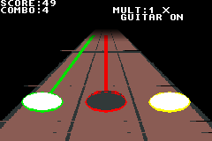
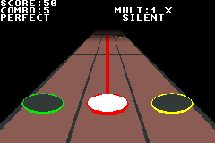
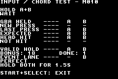
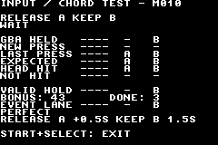

# Mission 010 stabilization

## Pre-change baseline

Source: `mission-009-sustain-gameplay`, final review commit `f589e62a225651c7bd8a39ad27f517e3890cd1fb`.
Implementation: `85c637d4cf1c1029fbf8d2413ba0a63274ef234b`.
HUD/results hotfix: `71f0152c29d7008acd310808861643d5018e65a7`.
All mission source branch tips below were verified ancestors of this source.
Main remains `6c4e63460fab10733d8ff011045ee246e7201952`; initial repository commit `c27bd247a06561330a84773203772199fa210cdf`.
No download branch is used as a source base.

- `mission-001-reproducible-build`: `47d340e105ff3afb899b063683b2ee0dbc5b7943`
- `mission-002-note-judgment`: `533862124079a9dca1f84a6d88f54e40cde189cb`
- `mission-003-chart-importer`: `135a55c2a0de50a4c68610f1aeb288924508bb54`
- `mission-004-universal-import`: `1487532557a1e98b1c99c6628e5d65c291268cd2`
- `mission-005-first-playable-import`: `f23cb6b4039fec93811b80f557a85518b2f626d1`
- `mission-006-audio-sync`: `4fa9e6f8b2558a129075c9815c8bb2ac68e6421b`
- `mission-007-reactive-guitar-audio`: `90aaed9f2d7624258ff3485d6a0dc7858c126929`
- `mission-008-hotfix-hud-completion`: `71f0152c29d7008acd310808861643d5018e65a7`
- `mission-008-scoring-results`: `a6b36a22733992b274f352a190c9ec1d39547d1d`
- `mission-009-sustain-gameplay`: `f589e62a225651c7bd8a39ad27f517e3890cd1fb`

Download-only branches (do not merge):

- `mission-001-download`
- `mission-002-download`
- `mission-003-download`
- `mission-004-download`
- `mission-005-download`
- `mission-006-download`
- `mission-006-playtest-download`
- `mission-007-download`
- `mission-007-playtest-download`
- `mission-008-download`
- `mission-008-hotfix-download`
- `mission-008-playtest-download`
- `mission-009-download`
- `mission-009-playtest-download`

M009 public synthetic SHA256: `57ac5cb4201cd2f37e1124f27a89d05c115ff466cd9cea8e9d25748ea7a4e264`; 807,776 bytes.
M009 Cream SHA256: `e2e5a9740e7b75efbb70b0ba8e37a1fabdf41873932b4e50482290340336d214`; 9,171,164 bytes.

GCC ARM 16.1.0, host FFmpeg 7.1.5, mGBA 0.10.1 Debian library. Pinned Docker toolchain in scripts/build-docker.sh. Prior host baseline: 98 Python tests plus C++ sanitizer programs. Prior emulator maximum foreground 170,176 cycles (60.58% of frame), tail strips 11 real /31 synthetic, refill max 1,344 cycles, zero ordinary underruns. Linked IWRAM 26,516/26,096 bytes, EWRAM 3,464/3,096 private/synthetic, before linker padding/stack.

Graphics baseline: horizon/fog bands, horizontal scanline seams and possible sprite popping; these were previously documented limitations, not all owner-visible symptoms reproduced. Current native frames and full-song baseline runs are captured before implementation.

Permissions audit: source tracks charts/careless.chart, original graphics and the original soundbank source (inspect music assets and provenance before wider redistribution). Historical download branches publish embedded Cream recording/chart in ROMs for M006–009; owner upload authorization is recorded in chat, but third-party redistribution rights are not established by that request. This needs a separate permissions review. Private generated chart/audio and Cream.zip remain ignored; ignore rules do not remove previously published history. No history rewriting or removal is performed. Mission010 public additions will be synthetic only.

## Implementation and regression result

Source implementation: `1d92104`; framebuffer/diagnostic acceptance improvements:
`53a6134`; stale-build verification and more informative failures: `3b0ce46`.
No production judgment, score, hold, PCM/guitar gate, chart policy, original art,
original699-note data, or Mode7 rendering algorithm was changed. Main's original
CRLF convention was restored after editing; final diff against M009 is small.

Input test is silent and isolated as mode3, while0/1/2 retain selector/original/
imported identities. It owns26synthetic note heads, five holds and13cases, and
uses the same NoteJudgment/Score/Holds classes without changing their rules.
It disables the Mode7 HBlank renderer while showing diagnostic text, then reuses
the existing fresh initialization on return to either actual gameplay path.
The selector has three entries; its sprite-font allocations do not overlap.
The supported mGBA runner was updated to navigate Up from Imported to Original,
rather than accidentally entering the new diagnostic entry.

All98Python tests and eight C++ ASan/UBSan executables pass (seven existing plus
new diagnostic model). Baseline before code changes also passed98Python/sevenC++
and eight real full-song scenarios. Final ten full395-note gameplay runs pass:

| Scenario | Score | Head behavior / sustain result |
| --- | ---: | --- |
| sustain-perfect | 15815 | 395Perfect;78complete;585bonus;395combo;FC/AP |
| sustain-release | 15446 | 395Perfect;78early;216bonus;395combo;FC/AP; no guitar mute |
| perfect | 15230 | 395Perfect;78early, no hold bonus |
| good | 7615 | 395Good;FC, no AP |
| miss | 0 | 395Miss;78missed hold onsets |
| scoring | 2465 | Mixed Perfect/Good/Miss, independent score checks |
| wrong | 3860 | Successful heads plus extra WrongInput, combo/guitar changes |
| reactive | 2630 | Mixed hits/misses; results/replay pass, waveform issue below |
| returnmenu / returnselect | 0 | Full song, B/Select navigation and fresh restart |

The250ms hold model independently reconstructs585/216bonuses. New input emulation
runs perfect/partial/wrong/early/stuck and confirms actual GBA sampled masks,
composed held/valid-hold labels, all13per-case outcomes, retry/exit and imported/
original sound after switching. It does not fabricate PASS from scripted intent.
Seventeen synthetic audio/gameplay/error scenarios pass, including visible error
screens, replay Start and both menu controls. Original three36000frame runs
resolve all699heads exactly once:699Perfect,699Miss and mixed, with original
sound and feedback. Silent synthetic and real395Perfect/Miss paths and older
fixed-mix compatibility are checked separately, not counted as reactive runs.
Four hidden-display injections fail as expected. Three invalid build-pair checks
fail as expected. Host/primary-gameplay successes do not erase unexpected failures.

### Graphics findings and usability

Native unedited final composed frames cover all requested gameplay/scene stages;
public evidence is in screenshots/mission010. The audit examined BG0receptors/
HUD, BG1depth mask/results, BG2affine highway, blend priorities, OBJ head IDs0–31,
affine IDs0–31 and tails32–127, tail tiles192–383, sprite font513onward, background
font128onward in separate character blocks, and map blocks24/30/31. No new tile
collision or out-of-range tail allocation was found. Zero tail overflow in tested
charts is not an unlimited chart capacity guarantee.

Independent inverse projection now checks tail lane placement as well as colored
composed pixels; head positions at first/middle/last remain within one frame.
Existing seams are reproduced with audio; silent frames remove the conspicuous
floor streaks. An isolated unshipped probe finds12,994late HBlank entries with
audio versus1silent. FIFO refill cost exceeds a1232cycle scanline, strongly
supporting interrupt contention rather than damaged artwork. A robust affine DMA/
IRQ scheduling repair is deferred because it changes scanline timing and needs
separate audio/hardware validation. No claim that all owner-reported popping or
obscured heads has been reproduced, and no existing graphics fix is claimed.

Normal Perfect/Good, combo/multiplier and guitar-state text are visible, but lane
identity and active-hold/bonus states remain weakly communicated. Diagnostic
labels expose those states. The approved future white/glowing-tail and near-fret
hit-feedback design is recorded in KNOWN_ISSUES, not implemented here.

### Unexpected audio analysis failure — stable promotion blocked

Seven primary real reactive waveform models pass, reference timing residuals
below0.733ms, zero clipping/ordinary underruns. The full mixed `reactive` capture
fails the unchanged >0.94 correlation criterion for a fade-down window at
232.665039s:0.909975, timing residual-0.671387ms. Fresh M009baseline analysis passes.
At the failing event, both traces agree on serial337, sample3812112, Miss, gain256
and gameplay tick3903571968. PCM/gate/clock source and prepared PCM streams are
unchanged; fractional alignment experiments did not resolve the mismatch.
An optional stricter common-backing comparison in `scoring` also fails at
46.137634s (0.998523versus>0.999), while that scenario's original primary model
passes. We do not know whether this is PWM/capture response or an audible defect.
No assertions, source windows or thresholds were weakened; only failure messages
were improved. QA-010-004 stays open and blocks a stable label/integration.

## Resource comparison and reproducibility

| Measurement | Mission009 | Mission010 |
| --- | ---: | ---: |
| Synthetic ROM bytes | 807776 | 814980 |
| Real ROM bytes | 9171164 | 9178392 |
| Real max foreground cycles /frame | 170176 | 170560 (60.72%;10.17ms) |
| Real run means, cycles/frame | historical means in logs | 99995.5–104720.5 (5.96–6.24ms) |
| Synthetic max foreground, normal scenarios | historical max not consolidated | 233728 (83.21%;13.93ms) |
| Synthetic means, normal scenarios | historical means in logs | 103512.0–131247.7 |
| Normal reactive refill max cycles | 1344 | 1472 |
| Tail strips peak real/synthetic | 11/31 | 11/31, no overflow |
| Linked IWRAM payload, real/synthetic | 26516/26096 | 27076/26660 |
| EWRAM payload, real/synthetic | 3464/3096 | 3464/3096 (+linker padding) |
| Ordinary audio underruns | 0 | 0 |

IWRAM numbers include code/BSS/data/constructors, before stack; runtime stack high
water was not measured. Timer profiling uses64cycle resolution and includes
interrupt overlap, excludes VSync wait; it is not full CPU utilization. No
physical GBA performance claim. Refill cost is comfortably below its16384cycle
FIFO interval but still too long for reliable interrupt-only scanline graphics.
EOF/results settle with the existing bounded catch-up and composed results checks;
replay produces new nonzero sound after fresh pre-roll, not stale buffer output.

Public ROM SHA256:
`48ff797804e86e59f70b4e733d5af651616a75b3d9dbe6bc1bb0026c1e6790ac`.
Private ROM SHA256:
`c48ca749df60522402cc77204e5100c1f3c7121244c97f2df8539892f62b8c5d`.
Clean source export + pinned Docker reproduced the public ROM byte for byte.
The two Windows-guide preparation/build commands were executed in that clean
Linux source export with an actual copy of the existing owner ZIP and reproduced
the private ROM byte for byte. Windows installation/UI is not claimed tested.
The test build ID is M010 QA; exact final source and download commits are recorded
in the delivery manifest/handoff. README links the separate synthetic bundle.

## Review status

Main unchanged; no merge, force push, history deletion, backup/stable tag, stable
branch or default-branch change. Consolidation is proposed in RELEASE_PROCESS,
not executed. Owner acceptance remains pending for M009sustains and M010changes.
Current lack of private attachment upload is documented with a real local build
fallback. New public assets are synthetic; previous public Cream history and
original music/art/code licensing need separate review. No new Cream download.
The next recommended milestone is narrowly scoped scanline/audio diagnosis and
owner-approved feedback polish; do not begin it before reviewing this evidence.

### Native graphics evidence

M009baseline (seams already present):

M010audio-on comparison (seam persists; no cosmetic fix claimed):

Same synthetic chart on the silent path (supporting IRQ diagnosis):

Received A+B and valid A+B holds, followed by intentional release of A only:

All four public synthetic primary waveform models pass. Older fixed-mix full-song
waveform/EOF analysis passes with unchanged limits. Current silent real395Perfect/
395Miss runs pass visible results, replay/menu and fresh zero-audio playback.
The failed initial fixed-mix preparation correctly rejected a stale chart-header
hash; subsequent compatibility testing uses its matching original prepared header.
A stale leftover-ROM test attempt was rejected by the existing head-observation
assertion; the new build-pair guard now catches this class before emulation.
No result from that stale attempt is counted as a passed fixed-mix test.
